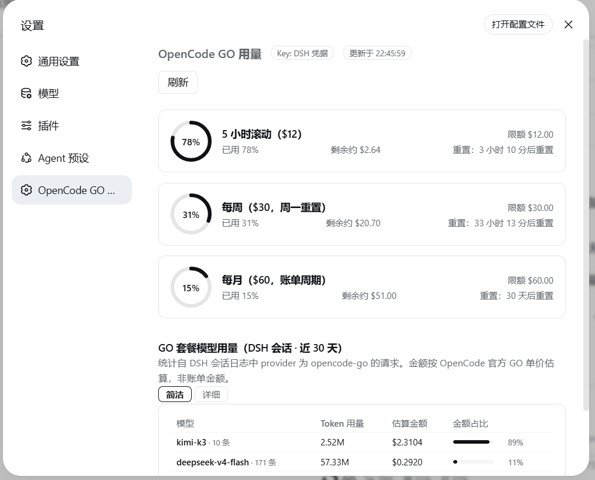
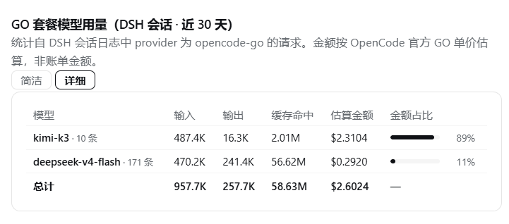
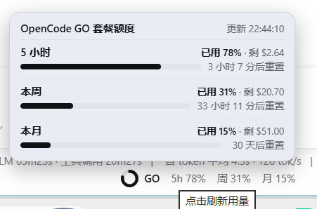

# dsh-go

> OpenCode GO 套餐用量监控插件 · 为 [DeepSeek Harness](https://github.com/deepseek-ai/deepseek-harness) Web GUI 而生

在 DSH 里一眼看清你的 **OpenCode GO 套餐**还剩多少：账户级三窗口额度（5 小时 / 每周 / 每月）环形图，加上从 DSH 会话日志聚合出的**按模型 Token 消耗与估算金额**，输入框下方还有一条随用随刷新的迷你指示。


---

## ✨ 功能一览

| 功能 | 说明 |
| --- | --- |
| 🍩 **三窗口环形图** | 5 小时滚动（$12）/ 每周（$30）/ 每月（$60）：已用 %、剩余约 $、重置倒计时，阈值变色（≥80% 黄、≥90% 红） |
| 📊 **按模型用量** | 从 DSH 会话日志聚合 provider 为 `opencode-go` 的请求：每个模型的 Token 用量与估算金额；**简洁 / 详细**模式切换（详细拆分输入 / 输出 / 缓存命中，DeepSeek 分档模型的金额再拆**高峰 / 闲时**） |
| 💲 **价格表查看** | 页面内「**查看价格表**」按钮：展开当前生效的官方 GO 价格表（USD / 每 1M token，含高峰/闲时分档列），标注同步来源与时间 |
| 📈 **每日趋势** | 近 30 天每日 GO 花费（估算）迷你趋势图 |
| 🪟 **输入框迷你条** | 仅当对话模型来自 GO 时显示 `5h / 周 / 月` 百分比；悬浮查看三窗口详情；**点击立即刷新** |
| 🎨 **主题自适应** | 全部样式走 `--dsw-alias-*` 主题变量（带明暗兜底），阴影用 `color-mix` 取主题色；圆角通过**通用元素探测**（默认直角 + 多数决 + 挂载/增删重探）自动跟随直角 / 圆角主题 |
| 🔑 **Key 自动解析** | `OPENCODE_GO_API_KEY` 凭据 → `auth.json`（opencode-go → opencode），无需手动配置 |

入口：**设置侧边栏 →「OpenCode GO 用量」** + **对话输入框下方迷你条**。

## 📸 截图

**设置页：三窗口环形图 + 按模型用量**



**详细模型用量查询**



**悬浮详情面板**



---

## 🚀 安装

已发布到 **npm**，推荐直接安装（本版本面向 DSH **0.2.1**，见下节「版本兼容」）：

```sh
dsh plugin --profile web add dsh-go-usage
```

也可以走 git 源（`dsh plugin` 走 pnpm，git 源同样没有 Windows 跨盘符路径问题）：

```sh
dsh plugin --profile web add github:6pofx/dsh-go
```

本地开发 / 离线安装（tarball 流程，Windows 上 `link:` 目录依赖有 pnpm 盘符 bug，勿用目录直连）：

```sh
# 1. 打包（产物为 dsh-go-usage-<版本>.tgz，如 dsh-go-usage-0.2.0.tgz）
npm pack

# 2. 拷到 profile 目录
cp dsh-go-usage-*.tgz $DSH_HOME/profiles/web/

# 3. 首次安装需在 $DSH_HOME/profiles/web/package.json 的 dependencies 加入：
#    "dsh-go-usage": "file:dsh-go-usage-0.2.0.tgz"

# 4. 物化依赖 + 自动注册 bundle 层（reconcile）
dsh plugin --profile web install

# 5. 重启 dsh web
```

插件通过包内 `cordis.patch.yml` + `dsh.bundle.patch` 声明**自动注入插件行**，无需手改 profile 的 `cordis.patch.yml` 用户层。

### 更新

```sh
dsh plugin --profile web update dsh-go-usage   # npm 源
# 或 git 源：dsh plugin --profile web update dsh-go
# 或 tarball：npm pack && cp dsh-go-usage-*.tgz $DSH_HOME/profiles/web/ && dsh plugin --profile web install
# 重启 dsh web
```

---

## ⚙️ 配置

Host 端参数写在插件行上（`dsh plugin` 安装后如需自定义，编辑 profile 的 `cordis.patch.yml` 用户层）：

```yaml
- insert:
    - id: opencode-go-usage
      name: dsh-go-usage
      config:
        baseUrl: https://opencode.ai/zen/go/v1/usage   # 默认
        timeoutMs: 15000                                # 默认
```

---

## 🔬 数据通路

| 数据 | 来源 | 说明 |
| --- | --- | --- |
| 账户级三窗口百分比 | `GET https://opencode.ai/zen/go/v1/usage`（Host `fetch` + Bearer key） | OpenCode 官方接口（未公开文档）；401=key 失效、403=无订阅。百分比含所有设备的用量 |
| 按模型 Token / 金额 | DSH 会话日志（`ctx.sessionQuery.readSession`，后台扫描 + 5 分钟缓存） | Token 精确；金额按 OpenCode 官方 [GO 单价表](https://raw.githubusercontent.com/anomalyco/opencode/dev/packages/web/src/content/docs/go.mdx) 估算，**非账单金额** |
| 官方价格表 | 启动时 + 每 24h 从官方 go.mdx 拉取并解析（GitHub raw 双源镜像，拉取失败回退内置表） | 价格自动跟随官方调价；**DeepSeek 按请求时间区分高峰 / 闲时计价**（高峰 01:00-04:00 / 06:00-10:00 UTC，价格 ×2）；页面标注价格表来源 |
| API Key | `OPENCODE_GO_API_KEY` 凭据 → `~/.local/share/opencode/auth.json`（opencode-go → opencode 条目） | 自动解析，页面显示来源 |

**重要说明**：官方接口只提供账户级百分比，不提供按模型拆分；按模型数据来自本机 DSH 会话日志，仅覆盖本机 DSH 产生的 GO 用量（其他设备 / opencode CLI 的用量不在此统计内）。

---

## 🏗️ 结构

```
dsh-go/
├── index.js          # Host 半：OpencodeUsageGateway（TypertRemoteService，方法 usage/refresh）
├── go-prices.js      # 官方价格表：解析 go.mdx + 24h 自动拉取（undici + curl.exe 兜底）+ 内置兜底表
├── typert.host.js    # 手写 Typert host 清单（zod 结果 schema），exports["./typert"]
├── client.js         # 浏览器 bundle（window.__ModuleLoader__.load），挂载 Remote + 两个槽位
├── cordis.patch.yml  # 插件行（dsh.bundle.patch 自动注入）
├── package.json      # 双面声明：main + exports ./client ./typert + dsh.client + dsh.bundle
├── test/             # DSH 0.2.1 契约回归测试（node test/compat.mjs，在 .compat/ 生成转出模块对接已安装的 DSH）
└── docs/dynamic-snapshot/   # 早期动态 Cordis 插件版本代码快照（已由正式版取代）
```

## 🔀 版本兼容

**0.2.0 起面向 DSH 0.2.1 线**（`engines.dsh = ">=0.2.1-rc.2 <0.3.0"`）。0.1.x 系列面向 0.1.0 ~ 0.1.5-rc 线，两者不通用。

0.2.1 改了三处本插件依赖的契约：

| 接口 | 0.1.x 线 | 0.2.1 线 | 本插件的做法 |
| --- | --- | --- | --- |
| Typert strict codec | `{ mode, typeSymbol, schema }` | **`{ mode, typeSymbol, create() }`**：注册表要求 `create` 是工厂，缺了就抛 `… strict codec has no create() factory`。该异常会让 typert gateway **撤回全部 strict 定义**（`SRC fallback is forbidden`），客户端 `session/control` 流随之打不开 —— 网页端表现为「暂无会话、无法操作」，而不只是本插件不可用 | `typert.host.js` 与 `client.js` 的每个 result codec 都改成 `create: () => zodSchema`（client 侧用直通 parser） |
| `ctx.settings` | 直接 `get(namespace)` 读原始配置 | 换成 `SettingsForms`（`describe/update/mutate`），**没有 `get()`** | 「设置 → 模型里有没有 `opencode-go`」改为多路探测：先用 `ctx.llm.listProviders()` 的实时路由，再退到 `settings.describe()` 的描述符，最后兜底旧版 `settings.get()`；全都不可用就返回 `null`（仅提示文案） |
| `dsh.client.inject` | 列 `@deepseek-ai/dsh-client-runtime` | 该包已不存在（`remote` 服务由 `dsh-api-gateway` 提供） | 注入列表同步为 `dsh-api-gateway` / `dsh-api-remotes` / `dsh-client-ui-settings` / `dsh-client-ui-model-selection` |

下列契约 0.2.1 **未变**，因此代码保持原样：`window.__ModuleLoader__.load({id, factory})` bundle 格式、`ctx.remote.$mount({package, descriptors})`、Slots（`settings.section` 的 `id/order/label`、`conversation.composer.dock`、`theme/change`）、`ctx.sessionQuery.listSessions/readSession`、`ctx.credentials.resolve(credentialRef(...))`、`ctx.timer.interval`、`./typert` 导出约定、`dsh.bundle.patch` 自动注入。

> 如果你在 0.2.1 上从 0.1.x 升级并曾因上面的 codec 报错把插件行 `disabled: true` 掉：升级到 0.2.0 后请把 `$DSH_HOME/profiles/web/cordis.patch.yml` 里 `opencode-go-usage` 的 `disabled` 删掉或改为 `false`，再重启 `dsh web`。

回归验证（隔离测试台直接对接**已安装**的 DSH 0.2.1 包；不联网、不需要 key）：

```sh
node test/compat.mjs        # 或 npm test
# host 17/17 · client 11/11
```

测试台不软链、不安装依赖：它在 `.compat/` 下为每个 `@deepseek-ai/*` 生成两行 `export *` 转出模块指向已安装的包（沙箱里禁止建符号链接时同样可跑），因此校验的是真实运行环境的版本。

## 🧩 开发

- **Host 半**：`index.js` 是纯 Node ESM，`fetch` / `node:fs` 原生可用；RPC 通过 Typert Remote（`opencodeUsage/usage`、`opencodeUsage/refresh`）
- **Client 半**：`client.js` 是手写 lazy-CJS bundle，`React.createElement` 渲染；所有颜色引用 `var(--dsw-alias-*, <兜底>)` 以自动适配任意主题（含魔改主题），圆角用通用元素探测跟随（无主题特化代码）
- 本地改动后按「更新」流程重新打包安装，并跑一次 `node test/compat.mjs`

## ⚠️ 已知限制

- 用量接口未公开文档，可能变动；解析已做防御式处理，非 200 响应显示友好状态而非崩溃
- 限额（$12 / $30 / $60）仅作展示参考，官方接口只返回百分比
- 模型金额为按官方 GO 单价估算（启动 + 24h 自动同步，失败回退内置表）；DSH 日志仅覆盖本机 DSH 产生的用量
- DeepSeek 高峰/闲时分档按每条消息的时间戳计价（权威时段以官方文档为准）；模型汇总金额为高峰 + 闲时事件的混合总和，同一天内不同时段单价不同，但已聚合数字不会随查看时刻变化；分档上下文模型（如 GPT 5.6 Luna / Qwen3.7 Plus）取低价档估算
- 迷你条仅在当前对话模型 provider 为 `opencode-go` 时显示

## 📚 参考

- [xiaoqi20/dsh-opencode-go-usage](https://github.com/xiaoqi20/dsh-opencode-go-usage) — 同款 DSH 插件（设置页三窗口），本包参考其 Host/Client 双面与 Typert 清单写法
- [andywang425/opencode-go-usage-api](https://github.com/andywang425/opencode-go-usage-api) — OpenCode Go 工作区页面抓取方案
- [tddworks/ClaudeBar](https://github.com/tddworks/ClaudeBar/commit/4ca0426f988c81d3a8c39610085be1c585bd6915) — 5hr/周/月配额 + 本地 DB 成本查询
- [Ychris12138/dsh-usage-stats](https://github.com/Ychris12138/dsh-usage-stats) — DSH 会话日志按模型聚合参考

## 📄 License

[MIT](./LICENSE)
